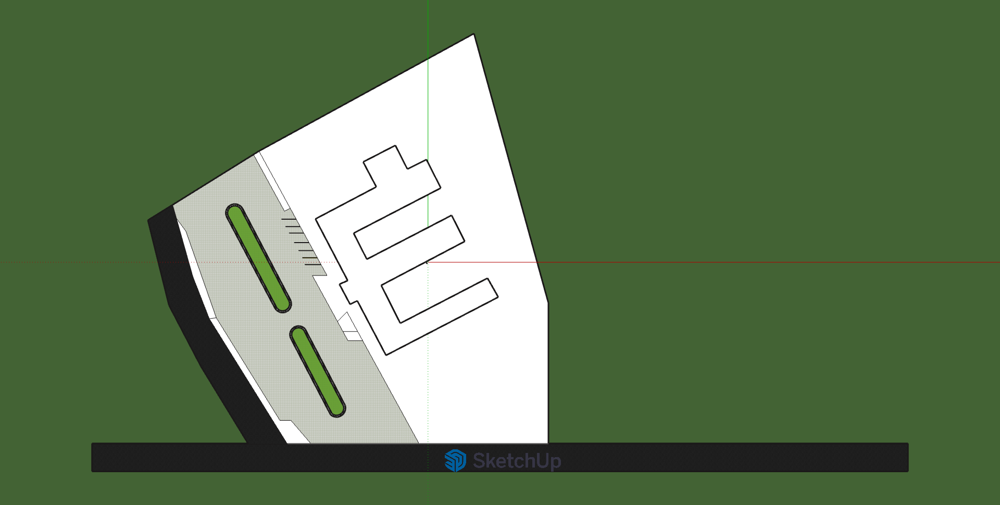
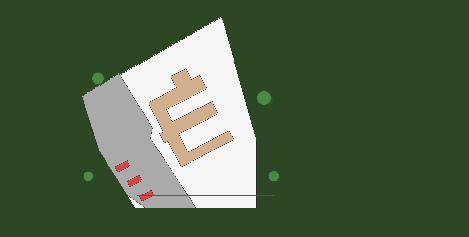
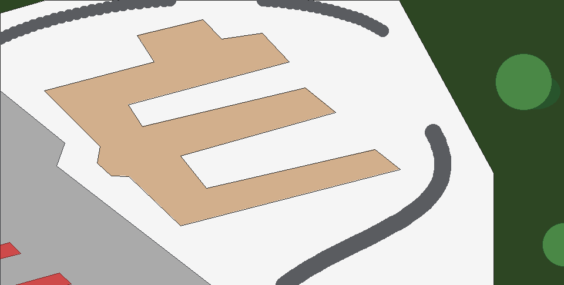
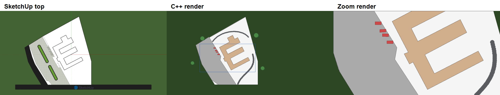

# CampusView 3D - Phase 1

**An Interactive Virtual Campus Tour** (Computer Graphics group project)

This repository is **Phase 1: Research & Planning** for *CampusView 3D* - a
3D, navigable model of a **section** of our campus, planned in SketchUp and
supported here by a from-scratch C++17 top-down renderer.

> We are **not** modelling the entire campus this semester. Phase 1 locks the
> scope, reference material, and first building footprint so later phases can
> grow into a guided walkthrough with hotspots and a mini-map.

## What CampusView 3D is

| Question | Answer (from the project proposal) |
| --- | --- |
| What are we creating? | A 3D model of a **campus section** in SketchUp, exported toward an interactive walkthrough |
| What will it do (later phases)? | Guided-tour camera path, clickable building hotspots / info cards, preset viewpoints, simple mini-map |
| Who is it for? | Prospective / first-year students, remote applicants, visitors, admissions & marketing |
| Why it matters | Flat maps don’t give a spatial sense of campus; in-person tours don’t scale |

### In scope this semester (proposal)

- Model **3-4 key buildings** plus connecting outdoor space, to scale
- Materials / textures and shadows for realism  
- One scripted guided-tour camera path  
- Hotspots with short info cards, viewpoint menu, mini-map  

### Out of scope this semester

- The **entire** campus  
- Photorealistic interiors / furniture-level detail  
- VR, multiplayer, live data, user accounts  
- Physics / game-style collision  

## Phase roadmap

| Phase | Focus | Status |
| --- | --- | --- |
| **1 - Research & Planning** | Reference photos/maps, agree scope, pick the campus section, SketchUp project + conventions, first footprint -> C++ scene | **In progress (this repo)** |
| **2 - Base 3D Modelling** | Block out ground & walkways, model 3-4 buildings, reusable components | Next |
| **3 - Materials & Lighting** | Textures, sun/shadows, atmosphere | Planned |
| **4 - Interaction & Animation** | Scenes, guided-tour camera, hotspots, viewpoints, mini-map | Planned |
| **5 - Test, Integrate & Present** | Integration, usability, export walkthrough, final docs | Planned |

### What Phase 1 delivers in this repo

1. A **SketchUp top-down reference** of the chosen campus section (`docs/sketchup_top.png`)  
2. A plain-text **scene file** digitizing that section (`assets/campus.scene`)  
3. A **C++ rasterizer** that redraws the site with course algorithms (no imported Warehouse meshes)  
4. Side-by-side SketchUp vs C++ images for the checkpoint  

The SketchUp model is the **position reference**. Cars and trees are redrawn as
simple **2D symbols** on purpose - that keeps the graphics focus on our own
line, fill, curve, and clipping code.

## Phase 1 render output

| SketchUp top view (Phase 1 reference) | C++ render | Clipped zoom window |
| --- | --- | --- |
|  |  |  |

Packaged side-by-side demo:



> **Design decision:** cars and trees are intentionally simplified to 2D
> symbols (rotated rectangles and filled circles). This is a modelling choice
> for Phase 1 graphics work, not a limitation of the final CampusView 3D vision.

## Graphics algorithms (Phase 1 checkpoint)

| Element | Technique | Source |
| --- | --- | --- |
| Building / road / car outlines | Bresenham line (all octants) | `src/raster.cpp` |
| Building / pad / lawn / parking fill | Scanline polygon fill (even-odd) | `src/raster.cpp` |
| Tree canopy | Midpoint circle + offset shadow ellipse | `src/raster.cpp` |
| Car | Rotated-rectangle polygon transform | `src/raster.cpp` |
| Bézier roads / scene file - @RichardJesse | Cubic Bézier sampled at 60 points, each chord clipped then stroked with a Bresenham centerline + round joints; roads read from `ROAD` lines in the scene file | `src/raster.cpp`, `assets/campus.scene` |
| Zoom / line clip | Cohen-Sutherland | `src/clipping.cpp` |
| Zoom / polygon clip | Sutherland-Hodgman | `src/clipping.cpp` |
| Scene input | Plain-text scene loader | `src/scene.cpp` |

- Lines / circles / cars - @derrickkimutai1: Bresenham lines (integer error
  term, all octants), midpoint-circle tree canopies with an offset shadow
  ellipse, and cars as rotated rectangles parked in the plaza's painted stalls.

**Design decision (unchanged):** cars and trees stay simplified 2D symbols
(rotated rectangles and filled circles). Phase 1 is about the 2D graphics
pipeline; real 3D vehicles and vegetation belong to later SketchUp phases.

### Clipping / zoom - @joekarogo

The zoom view (`output/campus_zoom.ppm`) re-renders the scene through the
`VIEWPORT` window, `190 190 510 351.67`. That window covers the E-building and the
plaza edge, and the full view outlines it in blue.

- **Road segments** are clipped with **Cohen-Sutherland**. Each endpoint gets
  a 4-bit outcode, so segments fully inside or fully outside are settled
  with two bit tests. The rest are trimmed to the window edges one at a time.
- **Pads, lawns, parking, buildings and cars** are clipped with
  **Sutherland-Hodgman**. The polygon passes through the left, right, bottom
  and top edges in turn, and each stage keeps the inside vertices and adds
  the edge crossings. This also handles the concave E footprint.
- The window has the same 960:485 aspect ratio as the canvas, so mapping it
  onto the canvas is a uniform **3×** zoom with no stretching. In the zoom
  image, the window edges visibly cut the E's top wing, the site pad, the
  plaza and a parked car.

These map to the proposal’s graphics themes (polygons, lines, ellipses,
transforms, viewing/clipping) while Phase 2+ move into fuller 3D SketchUp
modelling, materials, and interaction.

### Scanline fill / buildings - @derrickkimutai1

`fillPolygon` uses the **even-odd scanline** rule. For each pixel row it
intersects a horizontal line through the pixel centre (`y + 0.5`) with every
edge, sorts the crossing x values, and fills between pairs
`[x0,x1]`, `[x2,x3]`, …. Because inside and outside simply alternate, concave
shapes need no special case. A row through the E-building's arms produces 4-6
crossings, and the gaps between pairs are the notches between the arms. The
half-open edge test (`a.y <= y < b.y`) counts shared vertices once and skips
horizontal edges.

The `e_bldg` footprint in `assets/campus.scene` was re-traced from
`docs/sketchup_top.png`. Each corner is where two lines meet, each line fitted
by least squares to the outline pixels of one SketchUp edge, then converted to
half-scale scene coordinates.

## Project layout

```
campus-sketch/
├── include/        # public headers (one per module)
│   ├── color.h     # RGB color + palette
│   ├── geometry.h  # Point, Polygon, Rect, rotation
│   ├── canvas.h    # pixel buffer + PPM writer
│   ├── raster.h    # line, circle, fill, bezier, car
│   ├── clipping.h  # Cohen-Sutherland + Sutherland-Hodgman
│   └── scene.h     # scene model + loader
├── src/            # implementations + main pipeline
├── assets/         # campus.scene (edit this to change the campus)
├── output/         # generated PPM images (gitignored)
├── docs/           # SketchUp reference + README images
├── CMakeLists.txt
└── Makefile
```

## Build & run

With **Make**:

```bash
make          # builds ./campus
make run      # renders assets/campus.scene -> output/*.ppm
```

With **CMake**:

```bash
cmake -S . -B build
cmake --build build
./build/campus assets/campus.scene output/campus.ppm output/campus_zoom.ppm
```

Open `output/campus.ppm` in GIMP, IrfanView, or VS Code (PPM viewer
extension). To export PNGs for the README:

```bash
python3 -c "from PIL import Image; \
  [Image.open(f'output/{n}.ppm').save(f'docs/{n}.png') for n in ['campus','campus_zoom']]"
```

## Rendering pipeline

1. **Parse** the scene file into typed records (`scene::load`).
2. **Build** shape objects (polygons, Bézier control points, rotated rects).
3. **Clip** to the viewport window (Cohen-Sutherland / Sutherland-Hodgman).
4. **Transform** the window onto the canvas for the zoom view.
5. **Rasterize** into the pixel buffer, layering back-to-front:
   ground -> pads -> lawns -> roads -> parking -> buildings -> cars -> tree canopies.
6. **Write** the buffer out as a PPM image.

## Scene file format

Coordinates are pixels read off the Phase 1 SketchUp top-down screenshot
(origin top-left, +y downward). Editing the campus section is editing this
text file - no recompile.

```
CANVAS   960 485
VIEWPORT 280 120 560 400                     # optional zoom/clip window
PAD      site_pad  454 34  166 198  200 303  276 425  525 425  525 290
LAWN     planter   222 200  266 295  274 297  277 290  230 202
PARKING  plaza     166 197  202 307  258 398  297 425  401 425
BUILDING e_bldg    380 139  348 154  ...      # footprint (see campus.scene)
ROAD     access    410 420 440 350 520 340 495 250  8   # cubic Bezier
TREE     t1        200 160 12
CAR      c1        250 340 28 12 -28
```

**Adding a road.** `ROAD name x0 y0 x1 y1 x2 y2 x3 y3 [width]` is a cubic
Bézier: the curve starts at P0, ends at P3, and is pulled toward the handles
P1 and P2 (it does not pass through them). Roads are painted before parking and
buildings, so keep them on the pad/lawn or they are hidden. The header of
`assets/campus.scene` has a worked example.

`assets/campus.scene` was digitized from `docs/sketchup_top.png` (half-scale
pixel coordinates). Lines beginning with `#`, and inline `# ...` comments, are
ignored.

## Getting SketchUp data into Phase 1

1. Hide cars and trees tags if needed.  
2. Take a **top-down, parallel-projection** screenshot of the campus **section**;
   save it as `docs/sketchup_top.png`.  
3. Read building / pad / plaza corners into `assets/campus.scene`.  
4. Add simplified `TREE` / `CAR` symbols as 2D placeholders.  
5. Run `make run` and compare side by side.

## Team workflow (feature branches -> main)

Do **not** push straight to `main`. Each member works on a branch and opens a PR:

```bash
git checkout main
git pull origin main
git checkout -b feature/your-module
# ... work, commit ...
git push -u origin feature/your-module
# open a Pull Request into main
```

Suggested conventions:

- **One module per commit.** Prefix messages: `raster:`, `clipping:`, `scene:`, `docs:`.
- **Branch per feature** when work overlaps.
- **Update this README** when a Phase 1 milestone lands (algorithms row + images).
- **Don’t commit** `output/*.ppm` (gitignored); commit curated PNGs under `docs/`.

### Suggested Phase 1 ownership

| Member | Focus |
| --- | --- |
| akaditheepb | Bresenham lines, midpoint circles, car symbols |
| derrickkimutai1 | Scanline fill, building / pad footprints |
| joekarogo | Clipping + zoom viewport |
| RichardJesse | Bézier roads + scene file |
| emmanuelamor5 | SketchUp scope, integration, README / Phase 1 docs |

## Phase 1 checkpoint checklist

- [x] Campus **section** chosen and captured in SketchUp (top view)
- [x] Buildings drawn and filled from scene data
- [x] Trees via midpoint-circle code (simplified 2D symbols)
- [x] At least one curved path via Bézier curve
- [x] A clipped zoom window showing part of the section
- [x] SketchUp top view next to the C++ render in this README
- [x] Phase 1 scope + roadmap reflected for the whole team (this document)
- [x] Team PRs merged on feature branches for Checkpoint 1
