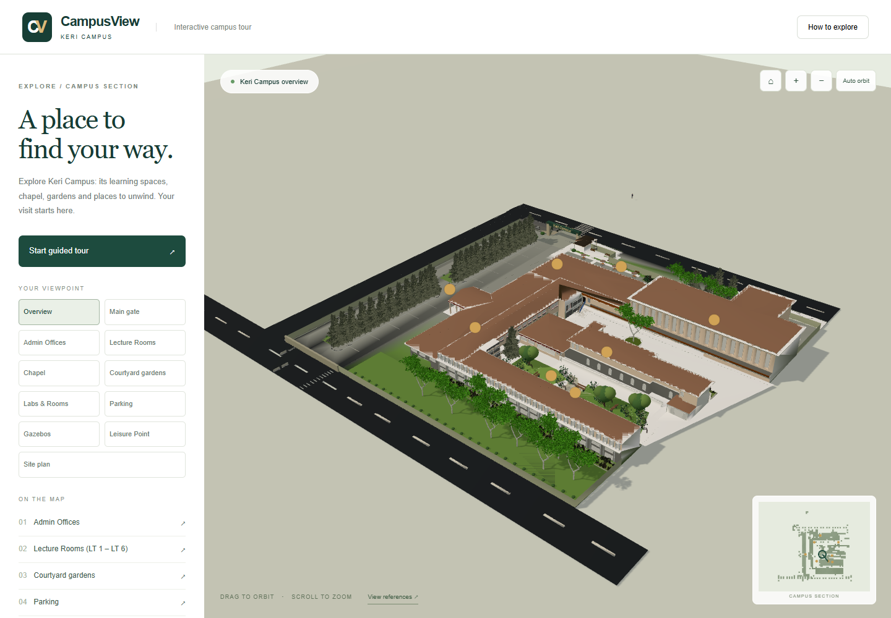

# CampusView browser viewer

A static 3D campus tour in `web/`, ready for GitHub Pages. No build step or runtime CDN is required. Three.js 0.170.0, OrbitControls and the text modules are vendored locally under the MIT license in `vendor/THREE-LICENSE.txt`. The Helvetiker font and its license are included locally in `assets/helvetiker_regular.typeface.json` and `vendor/FONT-LICENSE.txt`.

## Preview

From the repository root, run:

```sh
python -m http.server 8080 --directory web
```

Open http://localhost:8080 in a modern browser with WebGL and DecompressionStream support. Opening index.html directly through file:// does not support the model fetches and ES modules.

Drag to orbit, scroll/pinch to zoom, and right drag/two fingers to pan. The viewer includes eleven viewpoints, a guided tour, campus location cards and clickable markers, auto orbit, a geometry-derived mini-map and supplied reference images. Manual navigation stops the tour. Escape closes panels and stops the tour. Keyboard users can use the viewpoint, location and zoom buttons. Reduced-motion preferences disable viewpoint transitions.

## Model provenance

The model comes from the user's `Campus model.dxf.zip`, found beside the nine supplied campus screenshots. The converter preserves explicit meshes and transformed block instances, resolves CAD colors inherited from parent components, and samples selected texture images for representative surface colors. It leaves the original archive untouched. Malformed binary proxy graphics are skipped because explicit mesh geometry is available.

The browser model uses colors rather than full texture mapping. Standalone CAD lines and annotation are omitted. Fine vegetation is clustered on a 0.3-unit grid; architecture uses a finer 0.03-unit grid. Collapsed and duplicate triangles are removed, vertices are shared and the asset is gzipped for static hosting. Some fine details will differ from the screenshots.

The geometry is centred horizontally, grounded and normalized to a 180-unit span. Viewer units are not survey metres. `assets/campus.json` records the source bounds, scale, entity counts and optimization settings. Building names and functions follow the campus owner's supplied labels. Navigation uses an orbit camera and scripted viewpoints; interiors and collision are outside the current scope.

## Keri Campus locations and landscaping

`campus-data.js` defines the viewpoints and location cards: Admin Offices, Lecture Rooms (LT 1 – LT 6), Chapel, Labs & Rooms, Parking, Courtyard gardens, Gazebos and Leisure Point. The chapel is the middle building; Labs & Rooms is the building to the left of the highlighted courtyard. The guided tour includes all these stops.

`campus-landscape.js` applies the requested presentation changes after loading the CAD geometry: black road surfaces with light lane markings, greener lawns, planting, seating and shade trees. Courtyard planting sits above the raised CAD paving. It closes the previous gate opening, removes its gate components and crossing, opens the opposite boundary beside the gazebos, and adds an open gate with extruded **Keri Campus** lettering on both sides. The gate side was confirmed by the campus owner. These browser edits leave the CAD archive and compressed base model intact and survive model regeneration.

## Regenerate the model

```sh
python -m pip install --target .tools ezdxf pillow
python scripts/convert_campus.py "/absolute/path/to/Campus model.dxf.zip"
python scripts/optimize_campus.py
```

Conversion can take several minutes and requires substantial working memory for the source CAD. Commit `web/assets/campus.bin.gz` and `web/assets/campus.json` together. The large intermediate `campus.bin` and `.tools/` are ignored. Python and the CAD archive are not required by the deployed site.

The reference images are copies of the supplied `Campus model (4).png` (plan) and `Campus model (8).png` (perspective). The Phase 1 C++ renderer and scene data remain in `src/`, `include/` and `assets/`.

## Deploy to GitHub Pages

The workflow at `.github/workflows/pages.yml` publishes only `web/` on pushes to `main` or manual dispatch. All asset URLs are relative, so the site supports repository subpaths.

1. Merge the feature branch through a pull request.
2. In the repository's **Settings → Pages**, select **GitHub Actions** as the source.
3. Run **Deploy CampusView to GitHub Pages**, or push the merged change to `main`.
4. Open the deployment URL returned by the job, normally https://emmanuelamor5.github.io/campus-sketch/.

These local changes do not by themselves publish the site. A successful Pages workflow run is required.

## Verified preview



Browser checks covered all eleven viewpoints, eight location cards, guided-tour progression, Escape handling, reference dialogs and mobile overflow. Geometry checks verified black roadway vertices, light road markings, removal of old gate components, the new gate location and actual extruded lettering. Checks completed without page errors or failed asset requests.

[Gazebo-side gate with extruded lettering](../docs/keri-gate.png) · [Leisure garden preview](../docs/keri-leisure.png)
